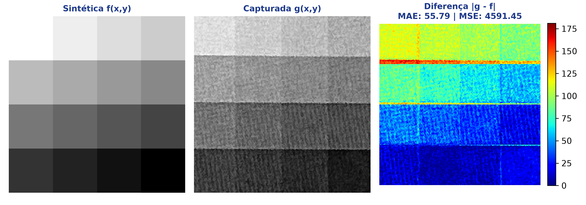
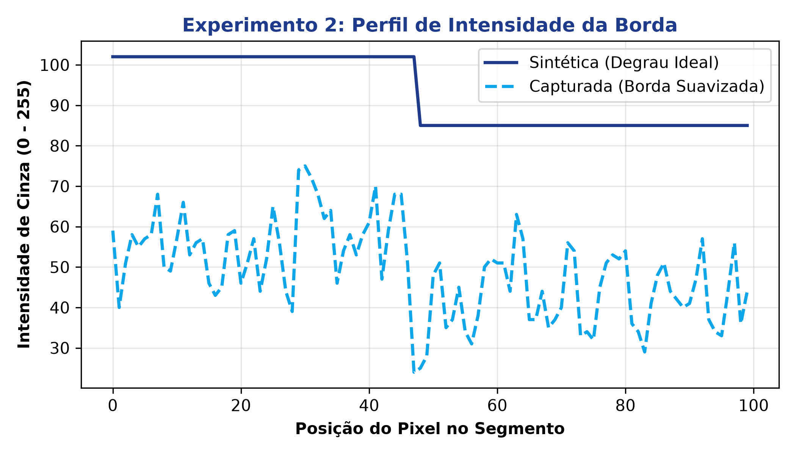
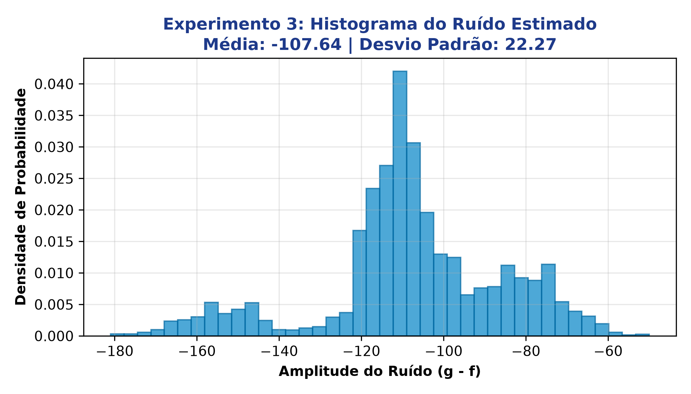
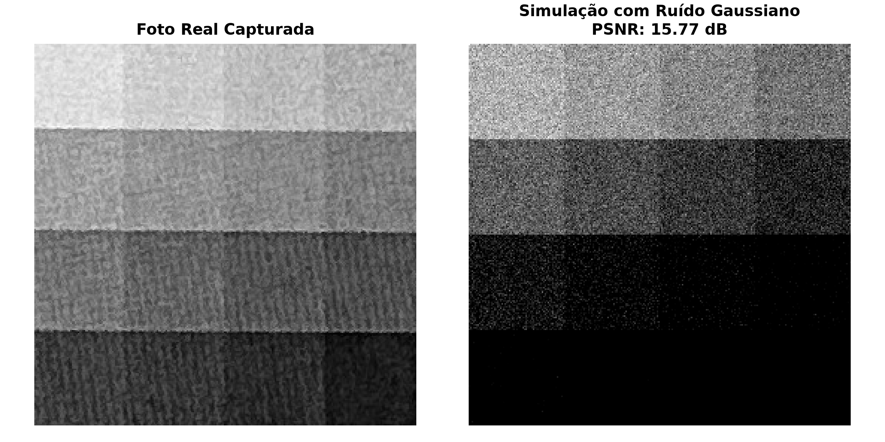
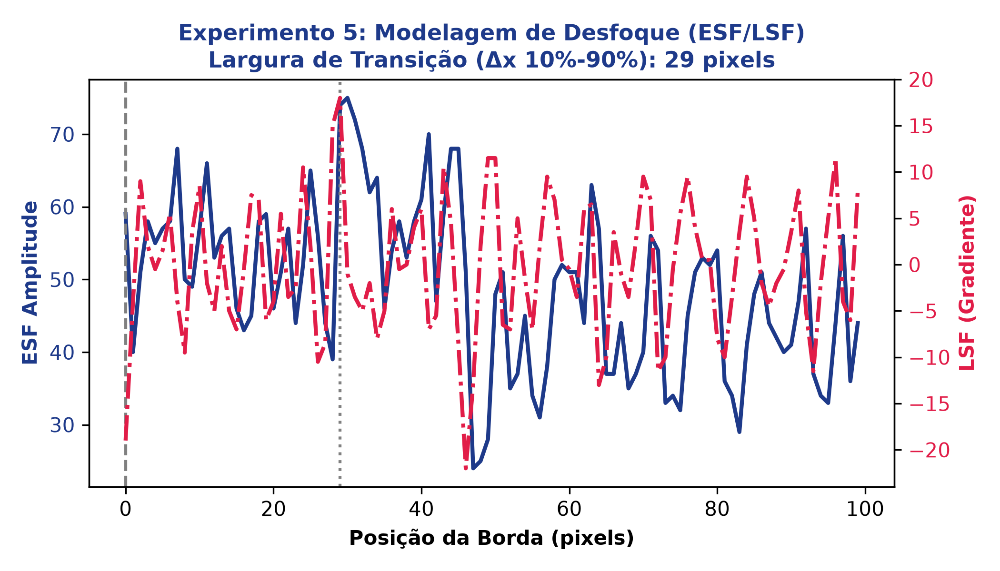

# Desafios de Processamento Digital de Imagens (PDI)

[](https://www.python.org/)
[](https://opencv.org/)
[](#)

Coleção de experimentos científicos voltados aos fundamentos matemáticos e físicos do **Processamento Digital de Imagens (PDI)**. O projeto investiga quantitativamente a transição entre imagens ideais geradas sinteticamente e fotografias reais capturadas por sensores ópticos.

---

## 📌 1. Visão Geral e Experimentos Validados

O repositório implementa cinco experimentos essenciais de análise e calibração de visão computacional:

1. **Experimento 1 (Alinhamento e Diferença Espectral):** Recorte central, reamostragem e cálculo da diferença absoluta $|g(x,y) - f(x,y)|$ com métricas de MAE e MSE.
2. **Experimento 2 (Perfil de Borda e Efeito Degrau):** Análise de corte unidimensional contrastando o degrau ideal da imagem sintética com a transição contínua e suave da captura real.
3. **Experimento 3 (Modelagem de Ruído de Sensor):** Extração de perturbações em regiões homogêneas de fundo e estimação empírica de média e desvio padrão gaussiano.
4. **Experimento 4 (Simulação de Degradação):** Injeção de ruído paramétrico sobre matriz sintética e mensuração da Relação Sinal-Ruído de Pico (PSNR).
5. **Experimento 5 (Estimativa de Desfoque Óptico via ESF/LSF):** Cálculo da *Edge Spread Function* (ESF) e sua derivada direcional *Line Spread Function* (LSF), identificando a largura de transição de 10% a 90% ($\Delta x$).

---

## 📊 2. Evidências Visuais da Execução Real

| Experimento | Evidência Gráfica |
| :--- | :--- |
| **Exp 1: Diferença e Alinhamento** |  |
| **Exp 2: Perfil de Borda** |  |
| **Exp 3: Histograma de Ruído** |  |
| **Exp 4: Degradação e PSNR** |  |
| **Exp 5: Curvas ESF / LSF** |  |

---

## ⚙️ 3. Como Executar

1. **Instale as dependências:**
   ```bash
   pip install -r requirements.txt
   ```

2. **Gere os modelos sintéticos em formato PPM:**
   ```bash
   python recorte.py
   ```

3. **Execute os testes e experimentos de comparação:**
   ```bash
   python codigo_desafio_2.py --synthetic img4.ppm --capture imgs/5-1Rec.JPG
   ```

---

## 📁 4. Estrutura do Repositório

```text
pid/
├── evidencias/                                  # Gráficos e evidências gerados
│   ├── exp1_diferenca_alinhamento.png
│   ├── exp2_perfil_borda.png
│   ├── exp3_histograma_ruido.png
│   ├── exp4_simulacao_ruido.png
│   ├── exp5_desfoque_esf_lsf.png
│   └── log_execucao_real.txt
├── imgs/                                        # Fotografias capturadas reais
│   └── 5-1Rec.JPG
├── temporario/                                  # Artefatos auxiliares
├── codigo_desafio_2.py                          # Algoritmos de comparação, ESF e ruído
├── recorte.py                                   # Gerador de matrizes PPM
├── PID_Fundamentos_Relatorio_Publicacao.docx    # Relatório executivo completo em Word
├── APRESENTACAO.md                              # Roteiro de pitch e divulgação
├── DesafiosPDI.pdf                              # Enunciados teóricos de referência
├── img4.ppm                                     # Modelo sintético de calibração
├── requirements.txt                             # Dependências Python
└── README.md                                    # Documentação técnica
```

---

## 📄 5. Material de Publicação

O documento executivo consolidado com todas as equações, gráficos com alta resolução e contextualização para portfólio profissional está disponível no arquivo [`PID_Fundamentos_Relatorio_Publicacao.docx`](file:///d:/projetos/pid/PID_Fundamentos_Relatorio_Publicacao.docx).
